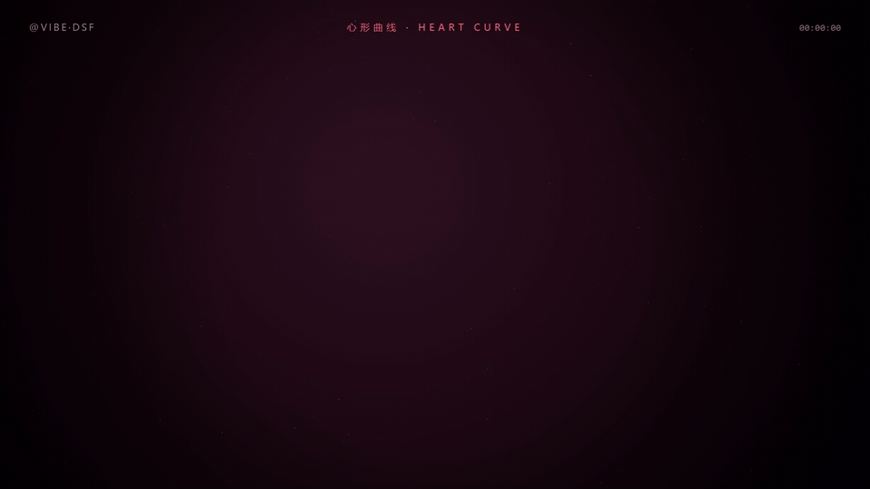

<div align="center">



**vibe-dsf — a fully-automated pipeline that turns a topic into a finished knowledge video.**

One command. No editor, no footage, no voiceover artist. **¥3–5 (~$0.5–0.7) per video.**

简体中文 | [English](README.en.md)

</div>

---

## What it does

```
topic → facts → script → storyboard → stills → full frames → QA gate → BGM + TTS → final.mp4
```

vibe-dsf renders **1080p knowledge videos the way "比特新语"-style channels do** (the fastest-growing
knowledge channel on Bilibili, 600k followers in half a month): motion-graphics frames drawn by code,
bilingual subtitles, beat-matched BGM — everything generated, rendered, scored and assembled by a
pipeline, with a **pixel-level QA gate** that refuses to ship anything scoring under 8/10.

Highlights from real runs:

| Capability | Status |
|---|---|
| Deterministic frame rendering (same t → same pixels) | ✅ verified, 0.13 s/frame via CDP |
| Pixel-level QA: motion, dead-black ratio, composition, accent color, subtitle safety | ✅ hard gate, exit 1 under 8.0 |
| Deterministic BGM synthesis + **TTS narration with ducking** | ✅ |
| SCENE-WRITER: auto scene planning + reusable motion blocks | ✅ |
| **PAPER2VIDEO: paper → popular-science video** (first film scored 9.5/10) | ✅ |
| Cost: 2-min video | **¥3–5 off-peak** |

## Why it looks like this

The whole ecosystem is built around one model — **DeepSeek-Flash** — and compensates for its
well-known failure modes with engineering, not hope:

- Its "safe" symmetric aesthetics → translated into **10 grep-able hard bans** + a 4-layer
  composition template, then **measured by the QA scorer** (A/B test: 7.7 → 9.1)
- Its tendency to rewrite whole files → minimal-diff contract with per-round self-report
- Its unreliable self-evaluation ("looks fine") → **the QA gate decides, numbers only**

One rendering path, zero plugins. Every design decision exists because of how flash behaves.

## Quick start

```powershell
powershell -File scripts\setup.ps1          # health check (read-only)

cd projects\demo-26s                        # watch a finished 26s sample
node ..\..\pipeline\render_frames.mjs --stills 3,45,132      # your own stills
node ..\..\pipeline\render_frames.mjs --fps 30 --duration 26 # full render
python ..\..\pipeline\qa_check.py frames --fps 30 --json qa.json
powershell -File ..\..\pipeline\build.ps1 -Audio bgm.wav     # assemble final.mp4
```

See [`docs/`](docs/) for the full playbook (12 flash-specific tuning rules, A/B results,
motion emphasis, cover/opening patterns, PAPER2VIDEO).

## Status & honest caveats

- Engineering chain (render / QA / BGM / TTS / assemble): **tested end-to-end**.
- Methodology claims (10 failure modes, most tuning rules): **observation-based, not fully
  A/B-tested**. We say so in the docs.
- Landscape: 1920×1080 only (portrait was tried and deliberately dropped).

## License

Self-authored parts MIT. Upstream style metrics follow their own licenses — see README (中文) for attribution.
